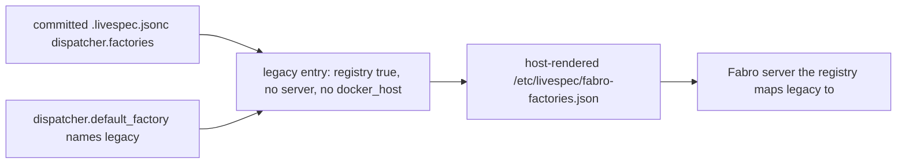

## Proposal: Factory routing

### Target specification files

- constraints.md
- scenarios.md

### Summary

Add a `## Factory routing` section to constraints.md requiring every committed dispatcher.factories entry in .livespec.jsonc to be registry-backed ("registry": true, no server, no docker_host) so no committed factory entry names a machine, and requiring dispatcher.default_factory to name legacy; add Scenario 34 to scenarios.md carrying both new clauses. The section adds two normative MUST lines to constraints.md, so the revision that lands it MUST also bind their gap-ids to Scenario 34 in tests/heading-coverage.json (a reasoned pending registration) and move the pinned clause counts in crates/console-spec-check/src/tests.rs to 288 (22/160/24/82) in the same change.

### Motivation

Coordinator rulings R318 and R320 (2026-10-20, plan petri-factory-on-gmktec, epic bd-ib-fyozyd) require every fleet repository's committed factory table to be registry-backed and name no machine; a factory is bound to a machine only in the fleet gitops inventory's factory registry. This heading is the governing clause the registry-switch work-item references. It is placed in constraints.md rather than non-functional-requirements.md because the factory a dispatch lands on is operator-observable (the console renders a dispatched item's factory name and server), and it sits beside Dispatcher-Settings Safety. Scenario 34 exists because this repository's behavioral-coverage gate requires every constraints.md clause to link to a live operator scenario.

### Proposed Changes

Append this H2 and body verbatim at the end of constraints.md, after the Dispatcher-Settings Safety section:

## Factory routing

Every entry this repository commits in `.livespec.jsonc` under
`dispatcher.factories` MUST be registry-backed: it declares
`"registry": true` and carries no `server` and no `docker_host` value, so
no committed factory entry names a machine. Which Fabro server answers to
a factory name is bound only in the fleet gitops inventory's factory
registry (livespec-dev-tooling `non-functional-requirements.md`
§"Fabro factory registry"), which each dispatching host renders as
`/etc/livespec/fabro-factories.json`; a dispatch resolves a
registry-backed entry from that file by name.
`dispatcher.default_factory` MUST name `legacy`.

Append this scenario verbatim at the end of scenarios.md, after Scenario 33:

## Scenario 34 -- A dispatch resolves its factory through the host's factory registry



```gherkin
Feature: Factory routing names no machine in committed configuration
  As a LiveSpec operator
  I want this repository's committed factory table to name no machine
  So that which Fabro server runs a dispatch is decided only by the fleet's factory registry

Scenario: The committed factory table is registry-backed
  Given this repository's committed `.livespec.jsonc`
  When its `dispatcher.factories` table is read
  Then every entry declares `"registry": true`
  And no entry carries a `server` or a `docker_host` value
  And `dispatcher.default_factory` names `legacy`

Scenario: A dispatch with no explicit factory lands where the registry maps legacy
  Given the dispatching host has rendered `/etc/livespec/fabro-factories.json` from the fleet factory registry
  When an item of this repository is dispatched with no explicit factory
  Then its Fabro run is created on the server address that file maps `legacy` to
```

