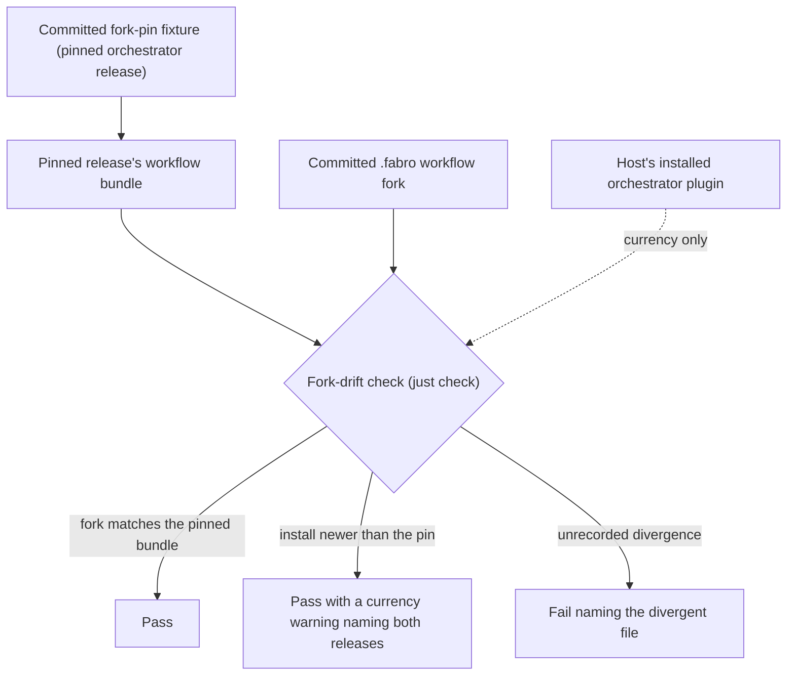

## Proposal: Fork-drift gate verdict against the pinned orchestrator release

### Target specification files

- SPECIFICATION/non-functional-requirements.md

### Summary

Add a Workflow-Fork Drift Gate clause subsection under ## Contracts and a new ## Contributor Scenario K stating the check-fork-drift behaviour: verdict from the release pinned in the committed fork-pin fixture; a newer installed orchestrator release is a currency warning with exit zero; an unrecorded divergence from the pinned release exits non-zero naming the file; the verdict is host-independent.

### Motivation

check-fork-drift (crates/console-fork-drift-check, in the just check aggregate) compares the committed .fabro fork against the orchestrator build the HOST has installed, so every orchestrator release that changes the workflow bundle turns console master red with no console commit. It refused every console push and post-merge janitor three times in three days (coordinator R316 for orchestrator v0.228.1, R498 for v0.229.9, R620 for v0.231.4; console PRs 1256, 1260, 1268), each a stop-the-line hand recovery. Work-item livespec-console-beads-fabro-lavbfp carries the root-cause fix, but no console spec heading governs fork-drift behaviour, so its Definition of Done could cite nothing that governs its assertions and its launch-time Definition-of-Done preflight failed (coordinator R631). This is a contributor-only gate, so it belongs in non-functional-requirements.md beside the Cross-Repo Action-Surface Parity clause.

### Proposed Changes

In SPECIFICATION/non-functional-requirements.md, under ## Contracts, immediately after the ### Cross-Repo Action-Surface Parity subsection (before ## Constraints), insert this subsection verbatim:

### Workflow-Fork Drift Gate

The console's committed `.fabro` workflow fork MUST be covered by a fork-drift check run inside `just check`. The check's verdict MUST be taken against the orchestrator release recorded in the committed fork-pin fixture (`tests/fixtures/fabro-fork-upstream-pins.json`), never against whichever orchestrator build the host running the check has installed, so that the verdict on a given console commit is the same on every host.

A committed fork file that differs from the pinned release's workflow bundle, outside a divergence recorded in the fixture with a non-empty reason, MUST fail the check, and the failure MUST name the file.

When the host's installed orchestrator plugin is a newer release than the pinned one, the check MUST print a currency warning naming both releases and MUST NOT fail on that ground alone. A Factory dispatch runs the console's committed fork, not the installed bundle, so a newer install is a currency signal, never a correctness one.

The pin MUST advance only through a committed change that re-syncs the fork against the newer release and re-takes the pins, so the upstream diff is design-reviewed as that change's review.

At the end of SPECIFICATION/non-functional-requirements.md, after ## Contributor Scenario J -- Cross-repo action-surface parity, append this scenario verbatim:

## Contributor Scenario K -- The fork-drift gate judges the workflow fork against its pinned orchestrator release



```gherkin
Feature: The fork-drift gate's verdict is a function of committed state
  As a LiveSpec contributor
  I want the fork-drift check to judge the committed fork against the release it pins
  So that an orchestrator release cannot turn the console's default branch red with no console commit

Scenario: A newer installed orchestrator release is a currency warning, not a failure
  Given the committed fork matches the workflow bundle of the release the fork-pin fixture pins
  And the host has installed a newer orchestrator release whose bundle differs
  When the fork-drift check runs
  Then it prints a currency warning naming the pinned and the installed releases
  And it exits zero

Scenario: An unrecorded divergence from the pinned release fails the check
  Given a committed fork file differs from the pinned release's workflow bundle
  And the fork-pin fixture records no divergence with a reason for that difference
  When the fork-drift check runs
  Then it exits non-zero naming that file

Scenario: The verdict does not depend on which host runs it
  Given two hosts with different installed orchestrator releases
  And the same console commit checked out on both
  When the fork-drift check runs on each
  Then both report the same pass or fail verdict for that commit
```

In the same change, tests/heading-coverage.json MUST gain a row for scenario "Contributor Scenario K -- The fork-drift gate judges the workflow fork against its pinned orchestrator release" (scenario_file non-functional-requirements.md, work_item livespec-console-beads-fabro-lavbfp) binding the new clauses' gap ids, and tests/heading-coverage-debt.json MUST be regenerated from the registry.
